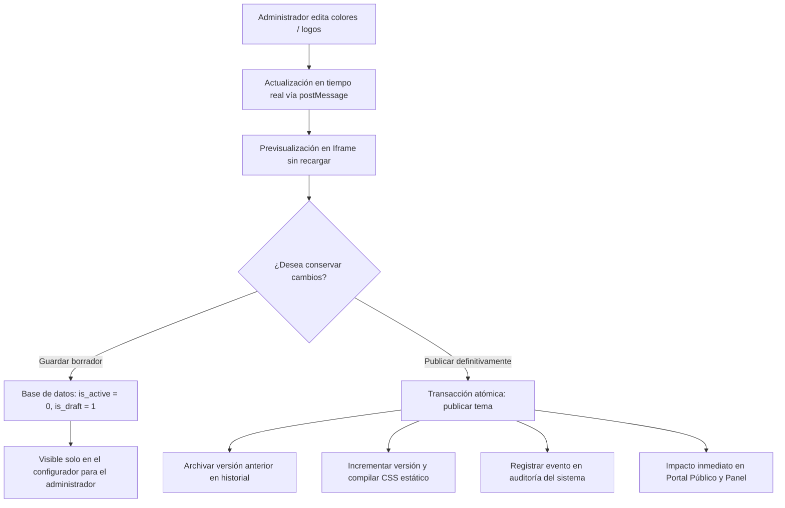

# Manual de Personalización de Identidad Institucional y Apariencia

> **Módulo:** Configuración → Apariencia e Identidad Institucional  
> **Ruta de acceso:** `/admin/apariencia`  
> **Rol requerido:** Administrador Institucional (`institution_admin`) o Superadministrador (`superadmin`)  
> **Ámbito de aplicación:** Exclusivo para la institución activa en la sesión (aislamiento multi-tenant estricto).

---

## 1. Introducción y Propósito

El módulo de **Apariencia e Identidad Institucional** permite a los administradores de los institutos de educación superior tecnológica y pedagógica del Perú configurar de manera autónoma, visual y segura la identidad corporativa de su repositorio digital.

Toda personalización se efectúa desde la interfaz gráfica web y **no requiere modificar ningún archivo de código PHP, CSS ni JavaScript**. El sistema compila y versiona automáticamente los tokens CSS y garantiza que los cambios realizados por una institución jamás afecten la apariencia ni los datos de otra entidad.

---

## 2. Pestañas y Opciones del Configurador

Al ingresar a `/admin/apariencia`, el administrador dispone de una pantalla dividida en dos paneles: a la izquierda, los controles organizados por pestañas funcionales; a la derecha, un lienzo de **previsualización en vivo** con selector de tamaño de dispositivo.

```text
+-------------------------------------------------------+
|  Módulo de Apariencia e Identidad Institucional       |
+---------------------------+---------------------------+
| [Identidad] [Logos] ...   | [ Escritorio | Tablet | Movil ]
|                           |                           |
| Controles de configuración|   Lienzo de Previsualización
| Formulario de tokens      |   en Tiempo Real (iframe)
| Selectores de color HEX   |                           |
| Uploader de imágenes      |                           |
|                           |                           |
| [Guardar Borrador]        | [Publicar Cambios]        |
+---------------------------+---------------------------+
```

---

### 2.1 Pestaña 1: Identidad Institucional
Permite registrar y actualizar los datos formales de la institución pública:
- **Nombre Oficial:** Denominación institucional completa según resolución ministerial (ej. *Instituto de Educación Superior Tecnológico Público del Perú*).
- **Nombre Corto / Sigla:** Denominación abreviada (ej. *IESTP Perú* o *ITP*).
- **Lema Institucional:** Frase lema o misión que acompañará los encabezados y metadatos institucionales.
- **Descripción Resumida:** Párrafo descriptivo utilizado en la página de inicio y en las etiquetas meta para buscadores (SEO).
- **Pie Legal / Copyright:** Texto legal al pie de todas las páginas del repositorio.

---

### 2.2 Pestaña 2: Logotipos y Heráldica
Permite cargar los activos gráficos de la institución mediante un mecanismo seguro con validación estricta de formato MIME (`finfo`) y dimensiones:

| Activo Gráfico | Uso Principal | Formatos Admitidos | Dimensiones Recomendadas |
|---|---|---|---|
| **Logo Principal** | Cabecera del portal público y panel administrativo sobre fondo claro | PNG, WebP, JPEG | 400x120 px a 800x240 px (fondo transparente) |
| **Logo Alternativo** | Encabezados o pie de página con fondo oscuro o contrastante | PNG, WebP, JPEG | 400x120 px (versión en blanco/claro) |
| **Logo Compacto / Escudo**| Visualización en móviles, sidebar colapsado y favicons auxiliares | PNG, WebP, JPEG | 120x120 px a 256x256 px (proporción 1:1) |

> **Nota de Seguridad sobre SVG:** Por política estricta de seguridad y prevención de inyecciones de secuencias de comandos (XSS mediante XML malicioso), **no se admite la carga directa de archivos SVG no sanitizados**. Utilice formatos WebP o PNG con canal alfa (transparencia).

#### Tratamiento en Caso de No Cargar Logotipo
Si un instituto nuevo no dispone aún de su logotipo digitalizado, el sistema genera de inmediato un **escudo con iniciales institucionales automáticas** (`brand-badge`) utilizando el color de fondo primario y texto en alto contraste, preservando la estética profesional del portal sin mostrar espacios vacíos ni imágenes rotas.

---

### 2.3 Pestaña 3: Favicon e Iconografía
- **Favicon Institucional:** Icono representativo mostrado en la pestaña del navegador, historial y marcadores.
  - Formatos admitidos: `.ico`, `.png`.
  - Dimensiones recomendadas: `32x32 px` o `64x64 px`.
- Se entrega con encabezados HTTP de caché controlada y versión para actualización instantánea en el navegador del usuario final.

---

### 2.4 Pestaña 4: Colores y Paleta de Marca

Permite definir los tres colores fundamentales de la identidad institucional:

1. **Color Primario (`--brand-primary`):** Color dominante del instituto (cabecera, botones principales, enlaces destacados).
2. **Color Secundario (`--brand-secondary`):** Color de apoyo para barras secundarias, bordes activos y fondos sutiles.
3. **Color de Acento (`--brand-accent`):** Color vibrante para llamar la atención en insignias, contadores y botones de acción clave.

#### Controles Disponibles:
- **Selector de Color Nativo:** Permite elegir cualquier tonalidad visualmente.
- **Campo HEX Sincronizado:** Permite ingresar el código hexadecimal exacto de la guía de marca institucional (ej. `#113b70`). Ambos controles se mantienen sincronizados en tiempo real.
- **Botón Restablecer:** Retorna el token individual a su valor predeterminado del sistema.
- **Alerta de Contraste WCAG 2.2 AA:** El sistema calcula instantáneamente el ratio de contraste contra el fondo blanco y oscuro. Si el ratio es inferior a **4.5:1**, se despliega una advertencia visual inmediata invitando a ajustar el tono.
- **Cálculo Automático del Color de Texto (`on-color`):** No requiere que el administrador configure el color de los textos; el sistema calcula automáticamente si corresponde texto blanco puro o texto oscuro de alto contraste.

#### Paletas Sugeridas de Inicio Rápido:
El administrador puede aplicar con un clic cualquiera de las 5 paletas base inspiradas en instituciones peruanas y posteriormente afinar los tonos:
- **Azul Institucional:** Primario `#113B70` · Secundario `#2873BD` · Acento `#E4AE35`
- **Verde Académico:** Primario `#145A42` · Secundario `#238263` · Acento `#D9AE50`
- **Granate Académico:** Primario `#702C44` · Secundario `#9E4B67` · Acento `#DCA64F`
- **Azul Petróleo:** Primario `#12485B` · Secundario `#1C7892` · Acento `#D5A447`
- **Morado Institucional:** Primario `#472E75` · Secundario `#7659AA` · Acento `#E5B64C`

---

### 2.5 Pestaña 5: Inicio, Portada (Hero) y Pie de Página

Configura los elementos de la página de aterrizaje del repositorio:
- **Estilo del Hero:**
  - *Color Sólido:* Fondo limpio con el color primario de la institución.
  - *Gradiente Elegante:* Transición armónica entre el color primario y el secundario institucional.
  - *Fotografía de Portada con Filtro:* Permite cargar una imagen del campus o biblioteca (`default_cover` / `hero`) aplicando un velo oscuro con transparencia para asegurar la lectura del buscador y título.
- **Título Prominente del Hero:** Frase principal de bienvenida (ej. *Producción Científica y Tecnológica del IESTP Perú*).
- **Subtítulo o Frase de Orientación:** Breve texto que orienta al investigador o estudiante.
- **Datos de Contacto y Redes Sociales:** Teléfono de mesa de ayuda, correo de biblioteca, dirección física y enlaces institucionales que se reflejarán en el pie de página.

---

### 2.6 Pestaña 6: Tipografía y Geometría
- **Pila Tipográfica:** Selección entre fuentes seguras del sistema (`System Sans-serif`, `Humanist UI`, `Modern Geometric`).
- **Radio de Bordes:** Selección del estilo de las esquinas de tarjetas y botones: *Suave (8px)*, *Estándar (12px)* o *Pronunciado (16px)*.
- **Sombra de Elevación:** Nivel de profundidad de las tarjetas académicas (*Sutil*, *Media*, *Plana*).

---

## 3. Flujo de Trabajo: Borrador, Previsualización y Publicación

El sistema implementa una arquitectura transaccional de dos fases para evitar que cambios accidentales o en proceso afecten al público:



### 3.1 Previsualización en Vivo sin Recargas
Cada ajuste en los selectores de color o textos se transmite mediante la API `window.postMessage` desde el editor hacia el `iframe` de previsualización. Esto actualiza las variables CSS del marco en milisegundos sin consumir peticiones HTTP ni perder la posición del scroll.

### 3.2 Selectores de Dispositivo
En la parte superior del visor de previsualización, el administrador puede alternar entre:
- **Escritorio:** Ancho completo (100%).
- **Tablet:** Ancho acotado a `768px` con centrado automático.
- **Móvil:** Ancho acotado a `375px` para verificar que los títulos, botones y menús no sufran desbordamientos.

### 3.3 Guardar Borrador
Al presionar **"Guardar Borrador"**, los tokens actuales se persisten en la tabla `institution_themes` con la marca `is_draft = 1`. El administrador puede cerrar sesión o volver días después y reanudar el trabajo exactamente donde lo dejó, sin que el portal público haya sido alterado.

### 3.4 Publicación Definitiva y Auditoría
Al presionar **"Publicar Cambios"**:
1. Se valida nuevamente la coherencia de todos los tokens en el servidor.
2. Se inicia una transacción en MySQL que marca el tema como `is_active = 1` y `is_draft = 0`.
3. Se incrementa el contador de versión (`version = version + 1`) para invalidar cachés de navegador de manera determinista (*cache busting*).
4. Se registra una entrada inmutable en la tabla de auditoría (`audit_logs`) con los datos del usuario, dirección IP, fecha exacta y los valores modificados (`before` y `after`).

### 3.5 Restauración de Versiones Anteriores
En la sección inferior del editor se listan las versiones históricas publicadas previamente. Con un solo clic en **"Restaurar esta versión"**, el sistema reestablece de inmediato la configuración previa y recompila los estilos, permitiendo deshacer cambios insatisfactorios en cualquier momento.
